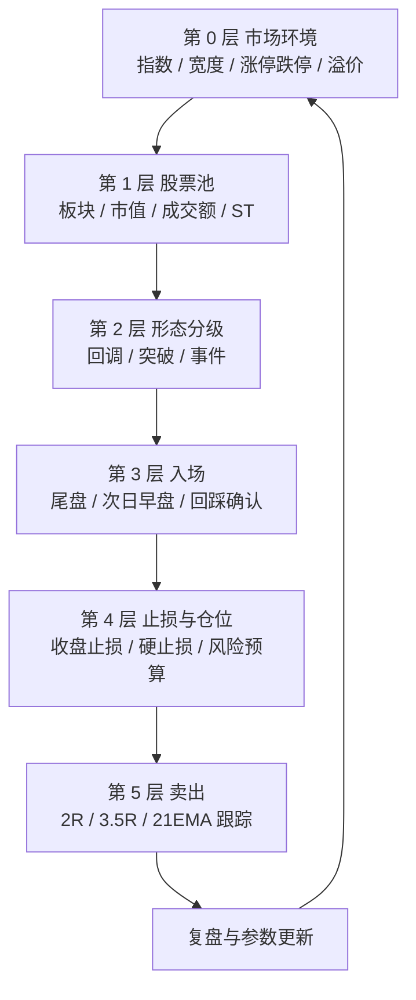

# A 股 T+1 强势股动量策略方案（v0.1）

| 项 | 内容 |
|---|---|
| 来源 | 港股交易员 Martin Luke 2025 美股投资冠军赛 969% 收益的思维导图 |
| 目标市场 | 沪深 A 股（主板 + 创业板） |
| 核心约束 | T+1、10%/20% 涨跌停、个股不能做空、题材与情绪驱动 |
| 文档状态 | **方案，未回测**；文中收益数字均为待验证假设，不是承诺 |
| 落地路径 | `research/` 事件驱动回测原型 → 稳健性检验 → `strategies/models/` |

---

## 0. 一页纸结论

**一句话**：在指数与情绪双红的日子，从"趋势向上 + 相对强度前 10% + 板块主线"的股票里，等它回踩 21EMA/AVWAP 缩量止跌，或放量突破 10–20 日平台，于尾盘或次日早盘买入；用 2%–5% 的收盘价止损，换 2.5R–3.5R 的盈亏比，单笔风险预算 0.3%–0.5%，分批止盈、21EMA 跟踪。

**原策略的真正内核不是选股，是风险单位。** 940 笔交易亏 731 笔（胜率 22.2%），仍能做出 969%，靠的是 14% : 2% = 7:1 的盈亏比：

```
期望 = 0.222 × 14% − 0.778 × 2% = +1.55% / 笔
```

A 股复制不了 7:1。把目标降到 **2.5:1–3:1**、胜率 **35%–45%**、期望 **0.35R–0.5R/笔**，已经是很好的策略。

**T+1 是最大的敌人。** 买入当天不能卖，日内止损失效，隔夜跳空会直接把 -2% 的计划亏损打成 -5%。方案用四道补丁：

1. 止损改为**收盘价触发、次日开盘执行**（T+1 起可恢复日内条件单）；
2. 仓位公式加入**跳空缓冲 `g`**，按"最坏成交"而不是"计划止损"定仓位；
3. 单笔风险预算从 0.5% 降到 **0.3%–0.5%**，按市场环境分档；
4. 设 **-6%/-8% 硬止损** + **跌停/停牌预案**，封住左尾。

**设计目标（待验证）**：年化 10%–20%，最大回撤 12%–18%，Sharpe 0.8–1.2，年交易 120–180 笔。

---

## 1. 原图拆解：哪些能搬，哪些必须改

### 1.1 十条主干

| # | 分支 | 原规则要点 | 迁移评级 | 判断 |
|---|---|---|---|---|
| 1 | 引言 | 低胜率、高盈亏比、先控亏后谈盈利 | ★★★★★ | 直接保留，作为第一性原则 |
| 2 | 体系概述 | 1R = 单笔止损额；止损越紧，同等风险可买越多 | ★★★★★ | 保留，但需区分"价格 R"与"账户 R" |
| 3 | 指标工具 | EMA 9/21/50/150、AVWAP、成交额、ADR | ★★★★★ | 全部保留，参数按 A 股波动重标 |
| 4 | 选股 | 市值/成交额/周换手/21EMA；盘前跳空；板块效应 | ★★★★ | 保留框架，阈值全部本土化 |
| 5 | 回调买入 | 三条件 + 四支撑 + 分钟确认 | ★★★★ | 最适配 T+1，作为主力形态 |
| 6 | 突破买入 | 平台 + 突破前日高 + 开盘区间高 | ★★★ | A 股假突破多、涨停买不到，需加量能与次日确认 |
| 7 | EP 跳空 | 财报/新闻跳空 10% 追入 | ★★ | A 股高开低走多，改为回踩缺口确认 |
| 8 | 止损 | 日内止损、ADR 一半、≤5%、通常 3% | ★★ | T+1 下日内止损失效，必须重写 |
| 9 | 仓位 | 0.5% 风险、20%–30% 仓位、连亏下调 | ★★ | 降至 8%–15%，加跌停与相关性约束 |
| 10 | 卖出 | 3–5R 分批、21EMA 跟踪、放巨量卖 | ★★★★ | 保留，目标降到 2R–3.5R，加涨停规则 |
| 11 | 环境 | QQQ/IWM 9/21EMA + 龙头股 50/150MA | ★★★ | 改为中证 1000 + 市场宽度 + 情绪指标 |

### 1.2 三个不能直接搬的假设

| 原策略假设 | A 股现实 | 后果 |
|---|---|---|
| 买入当天可止损 | T+1，当天买入不可卖 | 日内 -2% 触发不了，只能看它跌到收盘 |
| 想卖就能卖 | 跌停封死无买盘；停牌直接锁死 | 止损可能连续失效，亏损远超 1R |
| 突破/跳空可成交 | 涨停排队买不到；一字板无量 | 回测若假设成交，收益会被系统性高估 |
| 可做空、可加杠杆 | 个股无做空；两融门槛与成本高 | 只能做多，靠仓位而非对冲控风险 |
| 美股小盘流动性 | A 股小盘易被操纵、闪崩 | 池子要卡流通市值与成交额下限 |

---

## 2. 第一约束：T+1 如何改写风险结构

### 2.1 止损从"日内"变成"隔夜"

假设入场 10.00 元，计划止损 9.70 元（-3%）：

| 场景 | 实际成交 | 实际亏损 | 相当于几个 R |
|---|---|---|---|
| 正常触发 | 9.69 | 3.1% | 1.0R |
| 次日低开 -2% | 9.50 | 5.0% | 1.6R |
| 次日低开 -5% | 9.25 | 7.5% | 2.4R |
| 次日跌停 | 9.00 | 10.0% | 3.2R |

**一笔低开就能吃掉两笔盈利。** 所以不能用"计划止损"直接倒推仓位，必须用"计划止损 + 跳空缓冲"。

### 2.2 有效止损距离

```
D_eff = d + g

d = 计划止损距离（入场价到结构位的距离）
g = 跳空缓冲 = clamp(0.5 × ADR20, 1.5%, 3.5%)
```

`g` 的经验值先用 `0.5×ADR`；Phase 1 回测时用真实数据校准：

> 统计所有"收盘跌破止损位"的样本，计算其次日开盘的额外跌幅分布，取 75–90 分位数作为 `g`。

### 2.3 仓位公式

```
r_budget = 单笔风险预算（占账户）
w        = min(r_budget / D_eff, w_max)
shares   = floor(equity × w / 入场价 / 100) × 100
1R_acct  = w × d          ← 账户口径的 1R
```

注意这里有两个 R：

- **价格 R**：`入场价 − 止损价`，用来设目标位、看图形；
- **账户 R**：`仓位 × 价格 R`，用来记绩效、算期望。

报告统一用账户 R，交易卡上写价格 R。

**算例**：账户 100 万，股价 20 元，ADR 5%，d 2.5%，g 2.5%，r 0.5%。

| 项 | 值 |
|---|---|
| D_eff | 5% |
| w | 10% |
| 买入金额 | 10 万 |
| 股数 | 5,000 股 |
| 正常止损亏损 | 2,500 元（0.25%，1R） |
| 跳空最坏亏损 | 5,000 元（0.50%，预算上限） |

### 2.4 四道补丁

1. **收盘价止损**：T 日买入当天只看收盘，跌破止损位次日开盘卖；T+1 起可挂日内条件单。
2. **硬止损**：收盘较入场 -6%（主板）/ -8%（创业板），或亏损达 2.5R，先到先执行。
3. **跳空缓冲**：进入仓位公式，不靠"止损单"兜底。
4. **跌停预案**：跌停当日挂单排队；打开即卖；连续跌停 2 日以上，用 IM/IC 期货对冲或减其他仓位。

---

## 3. 策略总览

### 3.1 五层漏斗



### 3.2 每日节奏

| 时点 | 动作 |
|---|---|
| 前一晚 | 更新环境分、股票池、观察名单；算好每只的 EMA/AVWAP/ADR/平台/止损位 |
| 09:15–09:25 | 看集合竞价：高开幅度、竞价量、是否一字板 |
| 09:30–10:00 | 处理持仓（止损/止盈）；突破型入场窗口 |
| 10:00–11:30 | 观察回调型是否到支撑；不追高 |
| 13:00–14:30 | 观察；记录异动 |
| 14:30–14:55 | 回调型主买入窗口；持仓去留决策 |
| 15:00 后 | 记录成交、更新 R 值、写交易日志 |

---

## 4. 第 0 层：市场环境（Regime）

### 4.1 四个指标

| 指标 | 算法 | 作用 |
|---|---|---|
| 指数趋势 | 中证 1000（000852）收盘 vs EMA21，EMA21 斜率 | 主开关 |
| 市场宽度 | 全 A 非 ST 中收盘 > EMA21 的占比 | 赚钱效应 |
| 涨停/跌停 | 涨停家数、跌停家数（剔除新股/ST） | 情绪温度 |
| 昨日涨停溢价 | 昨日涨停股今日平均涨幅 | 接力意愿 |
| 连板高度 | 最高连板数 | 周期位置 |

### 4.2 四档状态

| 状态 | 指数 | 宽度 | 涨停 | 跌停 | 昨日涨停溢价 | 总仓位 | 单笔 r |
|---|---|---|---|---|---|---|---|
| 进攻 | > EMA21 且斜率 > 0 | > 50% | > 60 | < 10 | > 0% | 60%–80% | 0.5% |
| 中性 | 指数在 EMA21 ±2% | 30%–50% | 30–60 | 10–20 | -2%–0% | 30%–50% | 0.4% |
| 防守 | < EMA21 且斜率 < 0 | < 30% | < 30 | > 20 | < -2% | 0%–20% | 0.3% |
| 极端 | 单日 < -3% 或跌停 > 100 | — | — | — | — | 0 | 停手 |

**状态切换要连续 2 日确认**，避免在 EMA21 附近反复打脸。

### 4.3 自身状态（比指数更重要）

| 条件 | 动作 |
|---|---|
| 连续 3 笔止损 | r × 0.75，暂停加仓 |
| 连续 5 笔止损 | 停手 2 个交易日 |
| 月度回撤 > 6% | 停手 1 周，只做复盘 |
| 连续 2 笔盈利且 ≥ 1R | 恢复原风险预算 |
| 月度胜率 < 30% 且期望 < 0 | 回测复核，参数不轻易改 |

---

## 5. 第 1 层：股票池

### 5.1 硬过滤

| 维度 | 规则 | 理由 |
|---|---|---|
| 板块 | 沪深主板 + 创业板 | 排除科创板（权限/流动性）与北交所（30% 波动） |
| ST | 排除 ST/*ST/退市整理 | 5% 跌停 + 退市风险 |
| 上市 | > 120 个交易日 | EMA150 需要，次新股波动失真 |
| 流通市值 | 30 亿–800 亿 | 太小易操纵，太大弹性差 |
| 成交额 | 20 日均 > 2 亿 | 容量与滑点 |
| 换手率 | 20 日均 2%–25% | 太低无人关注，太高是游资博弈 |
| 价格 | > 3 元 | 避开仙股与低价陷阱 |
| 位置 | 距 250 日高点 < 30% | 只做强势，不抄底 |
| 风险事件 | 排除近 30 日解禁/减持/问询/业绩预亏 | 黑天鹅 |

### 5.2 相对强度

- 20 日涨幅在全池的百分位 > 80%；
- RS 线（个股/中证 1000）在 20 日新高附近，或站上 20 日均线；
- 60 日新高优先，其次 20 日新高。

### 5.3 板块与主线

A 股是题材市，板块权重高于个股：

1. 概念板块 5 日、20 日涨幅排名，取前 10%；
2. 板块内涨停家数 ≥ 3，或板块涨幅 > 2% 且成交额放大；
3. 只做**前 3 条主线**，不碰杂毛；
4. 板块内选最强：涨幅最大、成交额最大、最先涨停、连板最高；
5. 板块高潮次日（涨停 > 15 家）不追，等分歧。

---

## 6. 第 2 层：三种形态

### 6.1 形态 A：回调买入（主力，50% 仓位）

| 条件 | 规则 |
|---|---|
| 前置 | 20 日内创 60 日新高，或突破平台 ≥ 5% |
| 回调 | 3–8 个交易日，回撤 ≤ 1.5 × ADR |
| 支撑 | EMA21 ±2%，或 AVWAP ±2%，或前高/缺口上沿 |
| 量能 | 回调期均量 < 突破日 60%，且 < 20 日均量 80% |
| 止跌 K | 阳包阴 / 锤子 / 十字星 / inside day，至少一种 |
| 止损 | `min(回调低点, EMA21) − 0.3×ADR`，d 须在 2%–5% |
| 目标 | 前高 + 1×ADR；2R / 3.5R 分批 |

### 6.2 形态 B：突破买入（30%）

| 条件 | 规则 |
|---|---|
| 平台 | 10–20 日，振幅 < 10% |
| 量能 | 平台期 20 日均量 < 前 20 日的 80% |
| 位置 | 价格在 EMA21 上方，距平台高 < 5% |
| 突破 | 收盘 > 平台高 × 1.005，量 > 1.5 × 20 日均量 |
| 幅度 | 当日涨幅 3%–7%；**不买涨停** |
| 止损 | 平台高 × 0.97，或突破日低点 − 0.3×ADR |
| 目标 | 平台高度投射，或 2R / 3.5R |

### 6.3 形态 C：事件/跳空（20%）

| 条件 | 规则 |
|---|---|
| 事件 | 业绩超预期、政策、订单、并购 |
| 跳空 | ≥ 5%，当日成交额 > 2 × 20 日均额 |
| 不追 | 当日不买，等 3–10 日 |
| 回踩 | 缺口上沿 / EMA9 / EMA21，缩量，止跌 K |
| 止损 | 缺口下沿，或回踩低点 − 0.3×ADR |
| 排除 | 跳空 > 15%、当日高开低走 > 5%、利好已兑现 |

### 6.4 形态优先级

```
回调 > 突破 > 事件
```

T+1 下，回调型的止损位最近、跳空风险最小，是主力；事件型隔夜不确定性最大，只做确认后的第二波。

---

## 7. 第 3 层：入场

### 7.1 时点

| 形态 | 决策 | 执行 | 说明 |
|---|---|---|---|
| 回调 | T 日 14:30 | 14:35–14:55 买满 | 最贴近原策略，收盘前确认支撑 |
| 突破 | T 日收盘后 | T+1 09:35–10:00 | 避免尾盘假突破；开盘 30 分钟确认 |
| 事件 | T 日收盘后 | T+1–T+5 回踩确认，尾盘 | 不追高，等第二波 |

### 7.2 跳空过滤

| 次日开盘 | 动作 |
|---|---|
| > +5% | 不追，等回踩 5 日均线 |
| +2% ~ +5% | 可买，但仓位 × 0.7 |
| -3% ~ +2% | 正常执行 |
| < -3% | 放弃，形态破坏 |
| 一字涨停 | 放弃 |
| 跌停开盘 | 不买 |

### 7.3 不买的清单

- 当日涨幅 > 7%（追高，T+1 无保护）；
- 连续涨停 ≥ 3 板（高位接力）；
- 巨量长上影 / 天量滞涨；
- 板块高潮次日；
- 财报前 3 日（除非事件型已确认）；
- 大盘防守档。

---

## 8. 第 4 层：止损

### 8.1 六类止损

| 类型 | 触发 | 执行 | 说明 |
|---|---|---|---|
| 结构止损 | 收盘 < S0 | 次日开盘卖 | S0 由结构位定，d 2%–5% |
| 硬止损 | 收盘 < 入场 × (1−6%) 主板 / (1−8%) 创业板，或亏损 ≥ 2.5R | 次日开盘无条件卖 | 封左尾 |
| 时间止损 1 | 5 日未达 +1R | 减半 | 资金效率 |
| 时间止损 2 | 10 日未达 +1.5R | 清仓 | |
| 移动止损 | +2R → 成本；+3R → +1R；之后 10EMA/21EMA | 收盘触发，次日执行 | |
| 事件止损 | 跌破 AVWAP / 缺口下沿 / 平台下沿 | 次日开盘 | 逻辑破坏，不等价格止损 |
| 大盘止损 | 指数 < EMA21 且跌停 > 30 | 全部减半 | 系统性风险 |

### 8.2 收盘止损 vs 日内止损

- **T 日（买入日）**：只能收盘止损，因为当天不能卖。
- **T+1 起**：股票已解禁，可以挂日内条件单，跌破 S0 即卖；同时保留收盘硬止损。
- **回测**：日线只能近似。
  - 乐观版：`low ≤ S0` 且当日可卖，按 `min(S0, open)` 成交；
  - 保守版：只在收盘价 < S0 时，次日开盘成交；
  - 两个版本都要跑，取差值作为"日内精度"的收益贡献。

### 8.3 止损宽度

```
d = clamp(0.5 × ADR20, 2%, 5%)
```

- d < 1.5%：太紧，被噪声打掉，放弃；
- d > 5%：太宽，盈亏比不划算，放弃；
- 结构位与 `0.5×ADR` 冲突时，取**更近**的结构位，但不能小于 1.5%。

---

## 9. 第 4 层：仓位

### 9.1 公式

```
r_budget = 0.5% / 0.4% / 0.3%      # 进攻 / 中性 / 防守
d        = clamp(0.5 × ADR20, 2%, 5%)
g        = clamp(0.5 × ADR20, 1.5%, 3.5%)
D_eff    = d + g
w        = min(r_budget / D_eff, w_max)
shares   = floor(equity × w / P / 100) × 100
```

### 9.2 上限

| 约束 | 值 |
|---|---|
| 单票上限（主板） | 15% |
| 单票上限（创业板 / 流通 < 80 亿） | 10% |
| 同时持仓 | 4–8 只 |
| 单行业 | ≤ 2 只 |
| 单概念 | ≤ 3 只 |
| 小盘合计（< 100 亿） | ≤ 60% |
| 总仓位 | 80% / 50% / 20% / 0（按 regime） |

### 9.3 加仓

- 只在浮盈 ≥ +1R 后加；
- 回踩 10EMA 不破，加原仓位 1/3；
- 加仓后总风险 ≤ 0.6%；
- 最多加一次，不摊平亏损。

### 9.4 连亏降档

| 连续止损 | r_budget |
|---|---|
| 0–2 | 正常 |
| 3 | × 0.75 |
| 4 | × 0.5 |
| 5 | 停手 2 日 |
| 恢复 | 连续 2 笔 ≥ 1R 盈利 |

---

## 10. 第 5 层：卖出

| 阶段 | 条件 | 动作 |
|---|---|---|
| 第一目标 | +2R（≈1×ADR） | 卖 1/3 |
| 第二目标 | +3.5R（≈1.75×ADR） | 再卖 1/3 |
| 移动 1 | 收盘 < 10EMA | 卖剩余 1/2 |
| 移动 2 | 收盘 < 21EMA | 清仓 |
| 涨停 | 封单 > 流通 1%，或一字板 | 持有，次日再看 |
| 涨停打开 | 开板且回封无力 | 卖 1/2 |
| 放量滞涨 | 量 > 2×20 日均量，且涨幅 < 2% 或上影 > 2×实体 | 卖 1/2 |
| 大盘转弱 | 指数 < 21EMA 且跌停 > 30 | 全部减半 |
| 黑天鹅 | 跌停/停牌 | 挂单排队；打开即卖；连续跌停用 IM 对冲 |

**T+1 细节**：买入次日才可卖，若 +2R 在 T 日盘中达到，只能 T+1 开盘卖，允许回吐一部分。回测必须体现这一点，不能假设当日成交。

---

## 11. 参数总表

| 层 | 参数 | 默认 | 范围 | 说明 |
|---|---|---|---|---|
| 环境 | 指数 | 000852 | — | 中证 1000 |
| 环境 | 宽度阈值 | 50% / 30% | ±10% | 进攻/防守 |
| 环境 | 涨停阈值 | 60 / 30 | ±20 | 进攻/防守 |
| 环境 | 跌停阈值 | 10 / 20 / 100 | — | 中性/防守/极端 |
| 池 | 流通市值 | 30–800 亿 | 20–1000 | |
| 池 | 20 日均成交额 | > 2 亿 | 1–5 亿 | |
| 池 | 20 日均换手 | 2%–25% | — | |
| 池 | 上市天数 | > 120 | 60–250 | |
| 趋势 | EMA | 9/21/50/150 | 固定 | 前复权 |
| 趋势 | EMA21 斜率 | 5 日 > 0 | — | |
| 强度 | 20 日涨幅分位 | > 80% | 70–90% | |
| 波动 | ADR 窗口 | 20 | 10–30 | |
| 波动 | ADR 范围 | 3%–8% | 2%–10% | |
| 回调 | 回调天数 | 3–8 | 2–12 | |
| 回调 | 回撤上限 | 1.5×ADR | 1–2 | |
| 回调 | 缩量比 | < 60% | 50–70% | 相对突破日 |
| 突破 | 平台天数 | 10–20 | 8–30 | |
| 突破 | 平台振幅 | < 10% | 8–15% | |
| 突破 | 放量比 | > 1.5× | 1.2–2.0 | 相对 20 日均量 |
| 事件 | 跳空幅度 | ≥ 5% | 3–10% | |
| 事件 | 等待天数 | 3–10 | 2–15 | |
| 止损 | d | 0.5×ADR | 2%–5% | |
| 止损 | g | 0.5×ADR | 1.5%–3.5% | 跳空缓冲 |
| 止损 | 硬止损 | -6% / -8% | -5%~-10% | 主板/创业板 |
| 止损 | 时间止损 | 5 日 / 10 日 | — | +1R / +1.5R |
| 仓位 | r_budget | 0.5% / 0.4% / 0.3% | 0.2–0.6% | 三档 |
| 仓位 | 单票上限 | 15% / 10% | 8–20% | |
| 仓位 | 持仓数 | 4–8 | 3–10 | |
| 卖出 | 第一目标 | 2R | 1.5–3R | |
| 卖出 | 第二目标 | 3.5R | 3–5R | |
| 卖出 | 跟踪均线 | 10EMA / 21EMA | — | |
| 成本 | 佣金 | 0.025% | — | 最低 5 元 |
| 成本 | 印花税 | 0.05% | — | 卖出单边 |
| 成本 | 过户费 | 0.001% | — | 双边 |
| 成本 | 滑点 | 0.1%–0.2% | — | 按成交额分层 |

---

## 12. 回测与验证方案

### 12.1 数据

| 数据 | 用途 | 现状 |
|---|---|---|
| 日线 OHLCV（前复权 + 原始价） | 信号 + 成交 | `ohlcv_1d` 已有 |
| 指数 000300 / 000852 / 399006 | 环境 | `market` type=idx |
| 概念/行业成分 | 板块 | `concept_*` 已有 |
| ST 历史、上市日、停牌 | 池过滤 | **ST 历史未接，需补** |
| 涨跌停价 | 成交约束 | 可由前收 + 板块规则算 |
| 财务公告日 | 事件形态 | `fin_*` 有，需确认 PIT |
| 5/15 分钟线 | 精确入场（可选） | 分时链路待接 |

### 12.2 撮合假设（关键）

| 环节 | 假设 |
|---|---|
| 信号 | T 日收盘后生成，不使用未来数据 |
| 入场 | T+1 开盘（默认）；另测 T 日收盘成交的敏感性 |
| 涨停买入 | 开盘价 ≥ 涨停价 → 不成交 |
| 跌停卖出 | 开盘价 ≤ 跌停价 → 不成交，顺延 |
| 停牌 | 不成交，顺延 |
| 止损 | 乐观版按 S0 成交；保守版按次日开盘 |
| 费用 | 佣金 + 印花税 + 过户费 + 滑点 |
| T+1 | 买入当日禁止卖出（复用 `TPlusOneLedger`） |

### 12.3 指标

- 收益：年化、累计、超额（对中证 1000）；
- 风险：最大回撤、回撤持续期、下行波动、VaR；
- 交易：胜率、盈亏比、期望 R、Profit Factor、最大单笔亏损、最大连续亏损；
- 稳健：分市场环境、分市值、分行业、分入场形态；
- 容量：单票成交额占日均成交额比例、策略资金上限。

### 12.4 分段与稳健性

| 检验 | 做法 | 通过标准 |
|---|---|---|
| 样本内 | 2018–2021 | 期望 > 0.3R |
| 样本外 1 | 2022–2023 | 年化 > 8%，回撤 < 20% |
| 样本外 2 | 2024–2025 | 期望 > 0.2R |
| 参数敏感性 | 关键参数 ±20% | 收益不塌方 |
| 剔除极值 | 去掉最好 5% 交易 | 仍正收益 |
| 随机入场日 | ±1 日 | 结论不变 |
| 成本压力 | 滑点 0.3% | 仍正收益 |
| 蒙特卡洛 | 交易序列 bootstrap | 5% 分位回撤可接受 |

### 12.5 常见坑

- **未来函数**：用当日收盘信号、次日开盘成交；财务数据必须用公告日，不是报告期。
- **幸存者偏差**：池子要含已退市/ST 历史，不能用当前成分回看。
- **涨停可买**：回测最容易被高估的地方，必须显式拒绝。
- **跌停可卖**：亏损端最容易被低估，必须顺延。
- **复权混用**：信号用前复权，成交用原始价；涨跌停用原始前收算。
- **滑点不足**：小盘股 0.2% 起，大单更高。
- **参数过拟合**：先定逻辑，再调参数；参数越少越好。

---

## 13. 风险、局限与"不可复制"

1. **969% 不可复制**。样本是 2025 年美股小盘动量牛市、比赛账户高集中、可能使用杠杆与做空；A 股 T+1、无做空、涨跌停，收益量级必然下降。
2. **77.8% 的交易是亏损的**。原策略胜率只有 22.2%，靠盈亏比赚钱。多数人连续亏 5 笔就会改规则，这是执行层面最大的风险。
3. **T+1 左尾**。跌停封死时止损失效，单笔亏损可能达到 3R–5R；仓位与硬止损只能缓解，不能消除。
4. **涨停买不到**。强势股最容易涨停，回测若允许成交，收益会被系统性高估。
5. **题材退潮的 A 杀**。A 股题材股可以在 3 天内回撤 30%，21EMA 跟踪来不及。
6. **数据质量**。ST 历史、停牌、复权、公告日 PIT 都有缺口，先补数据再谈回测。
7. **容量**。小盘股策略资金上限可能只有 3–5 亿，规模大了滑点吃掉超额。
8. **监管与风格切换**。程序化交易新规、量化监管、注册制退市，都会改变历史规律的有效性。

---

## 14. 落地路线

| 阶段 | 工作 | 产出 | 验收 |
|---|---|---|---|
| Phase 0（1–2 天） | 数据口径核查：ST 历史、停牌、涨跌停、公告日、概念成分 | 数据覆盖报告 | 2018–2025 无大面积缺口 |
| Phase 1（3–5 天） | 事件驱动日线回测原型，复用 `TPlusOneLedger` / `FeeModel` / `limit_prices` | `trades.csv`、`equity.csv`、指标 | 能跑通，T+1/涨跌停/费用全部生效 |
| Phase 2（3–5 天） | 参数敏感性、分段、分层、成本压力 | 稳健性报告 | 样本外年化 > 8%，回撤 < 20% |
| Phase 3（2–3 天） | 与现有 baseline 对比，冻结参数 | 策略卡 v1.0 | 期望 > 0.2R，PF > 1.3 |
| Phase 4（1–3 月） | 模拟盘 / 小资金实盘 | 实盘日志 | 与回测偏差 < 30% |

Phase 1 建议先写独立脚本（`research/` 或 `scripts/`），不要直接塞进 `strategies/models/`：现有横截面框架是周频调仓、`on_bar` 只对持仓调用，装不下"每日选股 + 逐笔止损 + T+1"的逻辑。跑通后再决定是否扩展框架。

---

## 15. 一页纸交易卡

**盘前**

- [ ] 环境分：进攻 / 中性 / 防守 / 极端
- [ ] 今日总仓上限：80 / 50 / 20 / 0
- [ ] 单笔 r：0.5% / 0.4% / 0.3%
- [ ] 观察名单 ≤ 10 只，每只写清：形态、触发价、止损价、目标价、仓位

**盘中**

- [ ] 持仓：先看止损，再看止盈
- [ ] 回调型：14:30 后确认支撑与止跌 K
- [ ] 突破型：09:35–10:00 确认放量站稳
- [ ] 不追 > 7%，不买涨停，不接高潮次日

**盘后**

- [ ] 记录每笔的 R、入场理由、执行偏差
- [ ] 连续 3 笔止损 → 降档
- [ ] 更新环境分与观察名单
- [ ] 每周复盘：期望 R、盈亏比、最大回撤、规则违背次数

---

## 16. 待确认问题

1. **资金规模**：决定容量与滑点假设（100 万 / 1000 万 / 1 亿）。
2. **板块范围**：是否包含科创板、北交所？（当前方案排除）
3. **数据精度**：只做日线近似，还是必须接 5/15 分钟线做精确入场？
4. **目标**：研究验证 / 半自动信号 / 全自动实盘？
5. **风险偏好**：单笔 0.3% 还是 0.5%？最大可接受回撤 10% 还是 20%？
6. **是否要事件形态**：财报/政策跳空需要公告日 PIT 数据，成本较高，可先砍掉。

---

> 下一步：确认上述问题后，按 Phase 0 → Phase 1 落地回测原型；先跑通"回调 + 突破"两种形态，事件形态放 v0.2。
